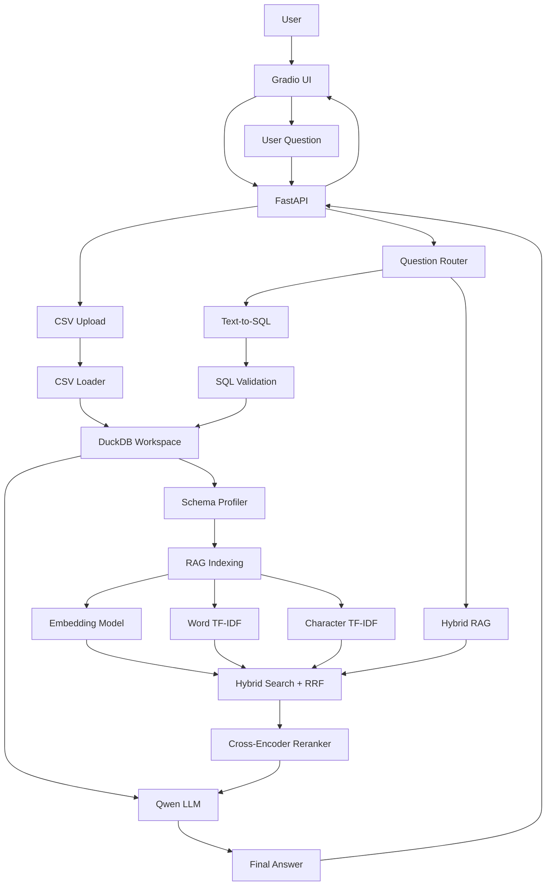

# CSV Chatbot — Text-to-SQL + Hybrid RAG

An intelligent bilingual chatbot that allows users to upload one or multiple CSV files, ask questions in Arabic or English, and get answers using **Text-to-SQL** and **Hybrid Retrieval-Augmented Generation (RAG)**.

The project combines structured data analysis with semantic retrieval using DuckDB, FastAPI, Gradio, Ollama, embeddings, and reranking.

---

## Project Overview

CSV Chatbot enables users to interact with their CSV datasets using natural language instead of writing SQL queries manually.

Users can:

- Upload multiple CSV files into one workspace.
- Automatically convert CSV files into DuckDB tables.
- Explore table schemas and column descriptions.
- Ask analytical questions using natural language.
- Generate and execute read-only SQL queries.
- Retrieve relevant information using Hybrid RAG.
- Ask questions in Arabic or English and receive answers in the same language.
- View generated SQL, query results, and retrieved RAG sources.

## Key Features

### 1. Multi-CSV Workspace

- Upload multiple CSV files in one session.
- Each CSV file is registered as a separate DuckDB table.
- All tables belong to one workspace and share one `dataset_id`.
- Supports queries across related tables using SQL JOINs.
- Generates a preview of uploaded data.
- Applies configurable upload limits.

### 2. Text-to-SQL

The chatbot converts natural-language questions into SQL queries.

Examples:

| User Question | Expected SQL Operation |
|---|---|
| What is the total sales? | `SUM(quantity * unit_price)` |
| What is the total quantity sold? | `SUM(quantity)` |
| How many orders are there? | `COUNT(DISTINCT order_id)` |
| Show sales by customer. | `JOIN` + `GROUP BY` |
| What are the top-selling products? | `GROUP BY` + `ORDER BY` |

Generated SQL is validated before execution to restrict queries to read-only operations.

### 3. Hybrid RAG

The RAG pipeline retrieves relevant information from the uploaded dataset and its schema.

It combines:

- Semantic vector retrieval.
- Word-level TF-IDF retrieval.
- Character-level TF-IDF retrieval.
- Reciprocal Rank Fusion (RRF).
- Optional Cross-Encoder reranking.

The retrieved context is passed to the LLM to generate a grounded answer.

### 4. Bilingual Support

- Arabic and English questions.
- Automatic language detection.
- Arabic and English schema descriptions.
- Responses generated in the language of the question.

---

## Architecture



### Important Architecture Decision

FastAPI is the single process responsible for accessing DuckDB and maintaining the RAG index.

Gradio acts only as the frontend:

- Uploads CSV files through the API.
- Sends questions through the API.
- Displays answers and results.

This design avoids opening the same DuckDB database from separate Python processes, which previously caused file-locking errors.

---

## Technology Stack

| Component | Technology |
|---|---|
| Programming Language | Python 3.13+ |
| Package Management | uv |
| Backend API | FastAPI |
| Frontend | Gradio |
| Database | DuckDB |
| LLM | Qwen 2.5 3B |
| LLM Runtime | Ollama |
| Embeddings | `intfloat/multilingual-e5-small` |
| Reranker | `Horizon-Labs/multilingual-reranker-small` |
| Semantic Retrieval | Sentence Transformers |
| Keyword Retrieval | TF-IDF |
| Hybrid Ranking | Reciprocal Rank Fusion (RRF) |
| Data Processing | Pandas |
| API Communication | Requests |

---

## Project Structure

```text
csv-chatbot/
│
├── api/
│   ├── __init__.py
│   └── main.py
│
├── app/
│   ├── __init__.py
│   ├── chatbot.py
│   ├── config.py
│   ├── csv_loader.py
│   ├── database.py
│   ├── embeddings.py
│   ├── rag.py
│   ├── schema_profiler.py
│   ├── text_to_sql.py
│   └── ui.py
│
├── tests/
│
├── data/
│   ├── uploads/
│   ├── databases/
│   └── indexes/
│
├── .env
├── .gitignore
├── pyproject.toml
├── uv.lock
└── README.md
```

### Main Modules

| Module | Responsibility |
|---|---|
| `api/main.py` | FastAPI application, upload, indexing, prediction, and health endpoints |
| `app/ui.py` | Gradio user interface |
| `app/config.py` | Application configuration |
| `app/csv_loader.py` | CSV parsing and validation |
| `app/database.py` | DuckDB connections, table registration, and SQL validation |
| `app/schema_profiler.py` | Dataset and column profiling |
| `app/embeddings.py` | Embedding model operations |
| `app/rag.py` | RAG indexing, hybrid search, and reranking |
| `app/text_to_sql.py` | Natural-language-to-SQL functionality |
| `app/chatbot.py` | Question routing and final answer generation |

---

## Installation

### 1. Clone the repository

```bash
git clone https://github.com/shimaa83/csv-chatbot.git
cd csv-chatbot
```

### 2. Install dependencies

```bash
uv sync
```

If multipart upload support is not installed:

```bash
uv add python-multipart
```

### 3. Install and run Ollama

Download Ollama from:

https://ollama.com/

Pull the Qwen model:

```bash
ollama pull qwen2.5:3b
```

Make sure Ollama is running and the model is available:

```bash
ollama list
```

### 4. Configure environment variables

Create a `.env` file in the project root.

Configure the variables according to `app/config.py`.

Example:

```env
OLLAMA_URL=http://localhost:11434
OLLAMA_MODEL=qwen2.5:3b

MAX_UPLOAD_MB=50
MAX_ROWS=500000

CACHE_ENABLED=false
```

Keep `.env` private. Never commit API keys, credentials, or local secrets.

---

## Running the Application

The application uses two processes.

### Terminal 1 — FastAPI

Run from the project root:

```bash
uv run uvicorn api.main:app --host 0.0.0.0 --port 8000
```

FastAPI documentation:

http://127.0.0.1:8000/docs

Health endpoint:

http://127.0.0.1:8000/health

### Terminal 2 — Gradio

```bash
uv run python -m app.ui
```

Open the interface:

http://127.0.0.1:7860

**Important:** Start FastAPI and use it as the only process accessing DuckDB. Do not run another Gradio process that directly accesses the same database files.

---

## API Endpoints

### 1. Health Check

`GET /health`

Checks API readiness and loaded models.

Example response:

```json
{
  "status": "healthy",
  "ready": true,
  "models": {
    "ollama": "qwen2.5:3b",
    "embedding": "intfloat/multilingual-e5-small",
    "reranker": "Horizon-Labs/multilingual-reranker-small"
  }
}
```

### 2. Upload CSV Files

`POST /upload`

Accepts multiple CSV files using multipart form-data.

The endpoint:

1. Validates uploaded files.
2. Parses CSV content.
3. Creates a unique `dataset_id`.
4. Registers each CSV as a DuckDB table.
5. Profiles the workspace schema.
6. Builds the RAG index.
7. Returns a preview and indexing information.

### 3. Ask a Question

`POST /predict`

Request:

```json
{
  "question": "What is the total sales in Cairo?",
  "dataset_id": "YOUR_DATASET_ID"
}
```

Example response:

```json
{
  "success": true,
  "route": "sql",
  "answer": "The total sales in Cairo are ...",
  "sql": "SELECT ...",
  "result": {},
  "context": null,
  "sources": []
}
```

The `route` indicates which approach was selected:

- `sql`: Text-to-SQL.
- `rag`: Retrieval-Augmented Generation.

The response also includes SQL results or retrieved sources when available.

---

## Example Dataset

You can test the project using two related CSV files.

### customers.csv

```csv
customer_id,customer_name,city,segment
1001,Ahmed Hassan,Cairo,Retail
1002,Mona Ali,Alexandria,Retail
1003,Omar Samir,Giza,Corporate
1004,Nour Khaled,Cairo,Corporate
1005,Salma Adel,Mansoura,Retail
1006,Youssef Mahmoud,Alexandria,Corporate
```

### orders.csv

```csv
order_id,customer_id,order_date,product,quantity,unit_price
5001,1001,2026-10-01,Laptop,1,32000
5002,1002,2026-10-02,Headphones,2,1800
5003,1001,2026-10-05,Mouse,2,450
5004,1003,2026-10-07,Monitor,2,7500
5005,1004,2026-10-09,Laptop,2,32000
5006,1002,2026-10-12,Keyboard,1,1200
5007,1005,2026-10-14,Printer,1,6800
5008,1006,2026-10-16,Monitor,1,7500
5009,1003,2026-10-18,Keyboard,3,1200
5010,1004,2026-10-20,Headphones,1,1800
```

Relationship:

```text
customers.customer_id = orders.customer_id
```

### Example Questions

**Text-to-SQL**

```text
What is the total sales in Cairo?
```

```text
Show total sales for each customer.
```

```text
How many orders does each customer have?
```

```text
What is the total quantity sold for each product?
```

**RAG**

```text
What columns are available in the customers table?
```

```text
Explain the structure of the orders table.
```

```text
What is the relationship between customers and orders?
```

### Important Metric Definitions

To avoid confusing different business metrics:

| Metric | Correct Calculation |
|---|---|
| Total Sales / Revenue | `SUM(quantity * unit_price)` |
| Total Quantity | `SUM(quantity)` |
| Number of Orders | `COUNT(DISTINCT order_id)` |

Quantity must never be described as sales revenue.

---

## Testing

Run the test suite:

```bash
uv run pytest
```

Check the API:

```bash
curl http://127.0.0.1:8000/health
```

Use Swagger UI to test `/upload` and `/predict`:

http://127.0.0.1:8000/docs

---

## Security and Limitations

- SQL execution is intended to be read-only.
- SQL validation restricts supported query operations, but regex-based validation should not be considered a complete security boundary.
- Uploaded files are subject to configurable size and row limits.
- The current architecture uses a single FastAPI process for DuckDB access.
- The RAG index is maintained by the API process and is not automatically shared between separate application processes.
- Production deployment should add authentication, per-user workspace isolation, resource limits, and stronger SQL validation.
- Large CSV files and model inference may require significant RAM and CPU/GPU resources.

---

## Future Improvements

- Persistent RAG indexing and workspace recovery.
- User authentication and workspace management.
- Better handling of CSV relationships and automatic join detection.
- More advanced SQL validation and query planning.
- Query caching and performance optimization.
- Automated evaluation for Text-to-SQL and RAG.
- Deployment with a scalable inference service.

---

## Author

**Shimaa**

GitHub: https://github.com/shimaa83

---

## License

Add a license file before distributing the project publicly.
